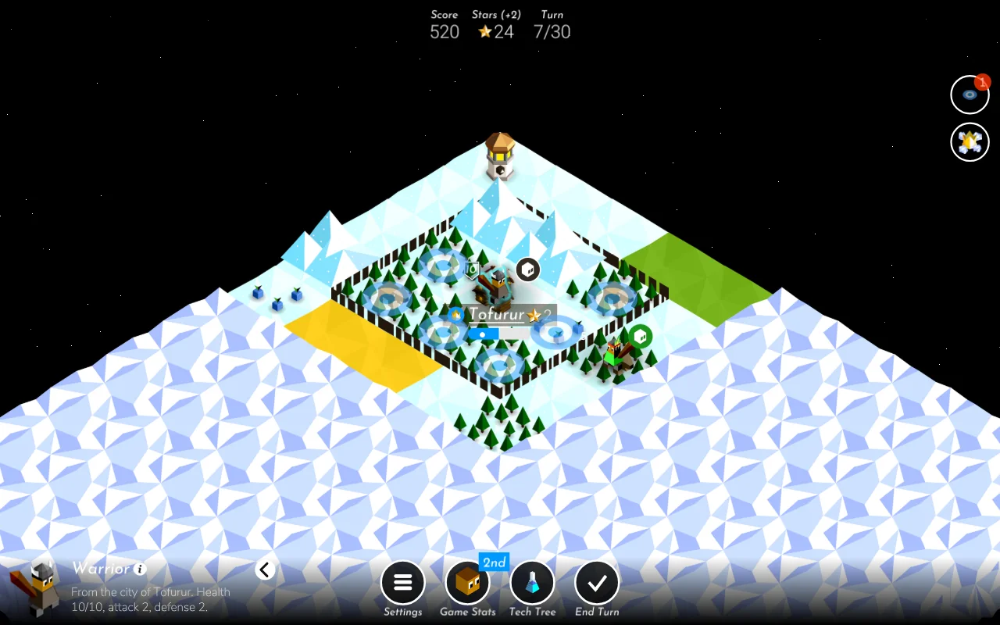
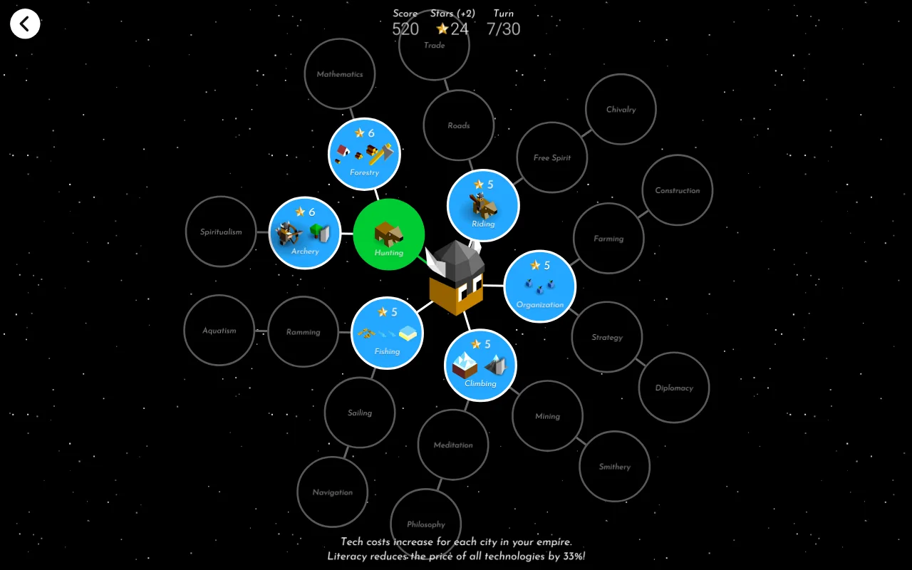
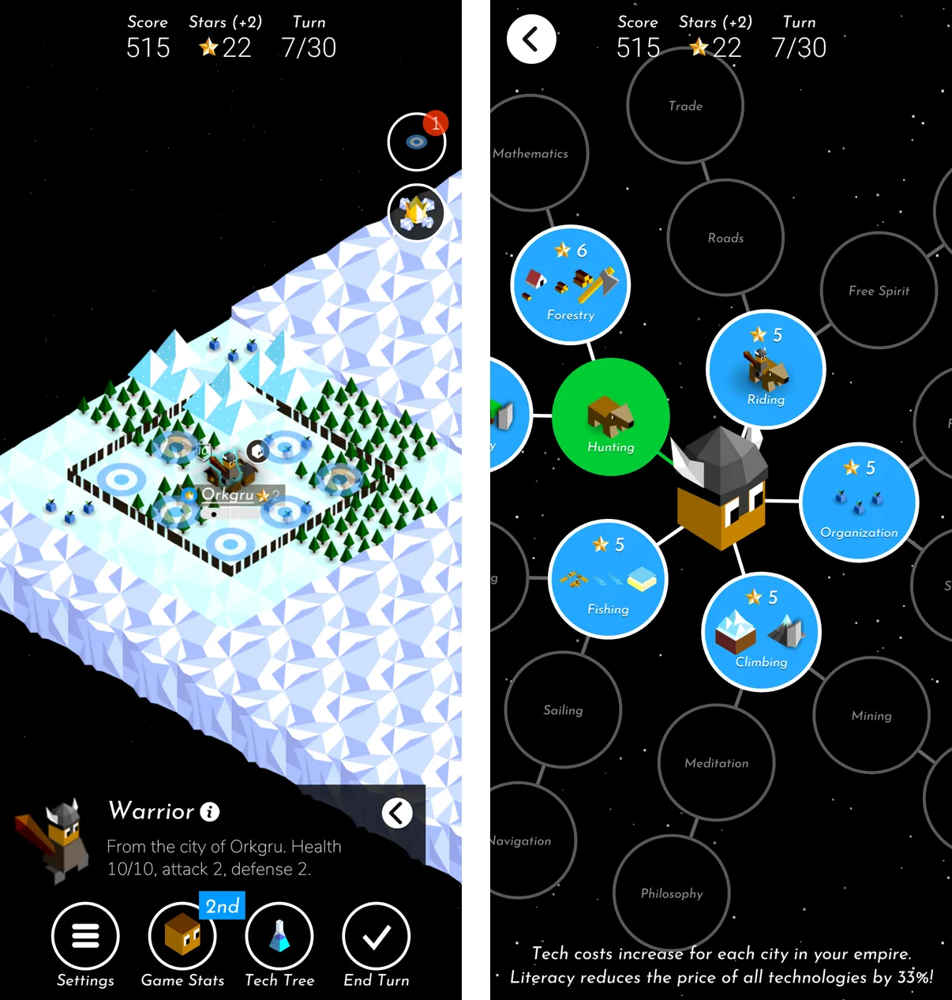

# Polytopia web UI

A Polytopia game screen for the browser: an isometric board drawn on a canvas, and the match screen around it with its
HUD, menus, tech tree, animation, sound and replay. Plain ES modules and CSS, with no build step and no dependencies.







## Layout

| Folder | Contents |
| --- | --- |
| `board/` | The board: terrain, cities, units, fog, camera and tile picking |
| `game/` | The match screen: turns and commands, animation, sound and replay |
| `game/ui/` | The HUD drawn on the canvas: top bar, selection bar, menus and tech tree |
| `ui/` | What the match screen is built on: base styles, API client, sheets, dialogs, toasts and music |
| `art/` | The game's art: tiles, cities, units, icons, fonts, sounds and music, with `manifest.json` describing each file |

## The board alone

`board/board.js` knows no game rules and needs nothing else here. It draws a position and reports taps:

```js
import { createBoard } from "board/board.js";

const board = createBoard(canvas, { meta, onTap({ xy, tile, unit }) {}, onLongPress({ xy }) {} });
board.setPosition(position, { fogFor: playerId });
board.setOverlays([{ kind: "move", cells: [[3, 4], [3, 5]] }, { kind: "attack", at: [5, 5], label: "-4" }]);
board.select([3, 4]);
board.centreOn([3, 4]);
```

## Requirements

- **An import map.** Modules import each other by name (`"ui/api.js"`, `"board/board.js"`), so the page maps those
  names to URLs.
- **Module URLs for the match screen.** `game/game.js` loads the rest of `game/` from the URLs in
  `<meta name="game-urls">`, a JSON object keyed by module name.
- **A JSON API** under `/api/` that serves each player's view of a game and takes their commands.
- **The `art/` folder served at `/art/`.** Without it the board uses its plain drawn look and the match screen is
  silent.
